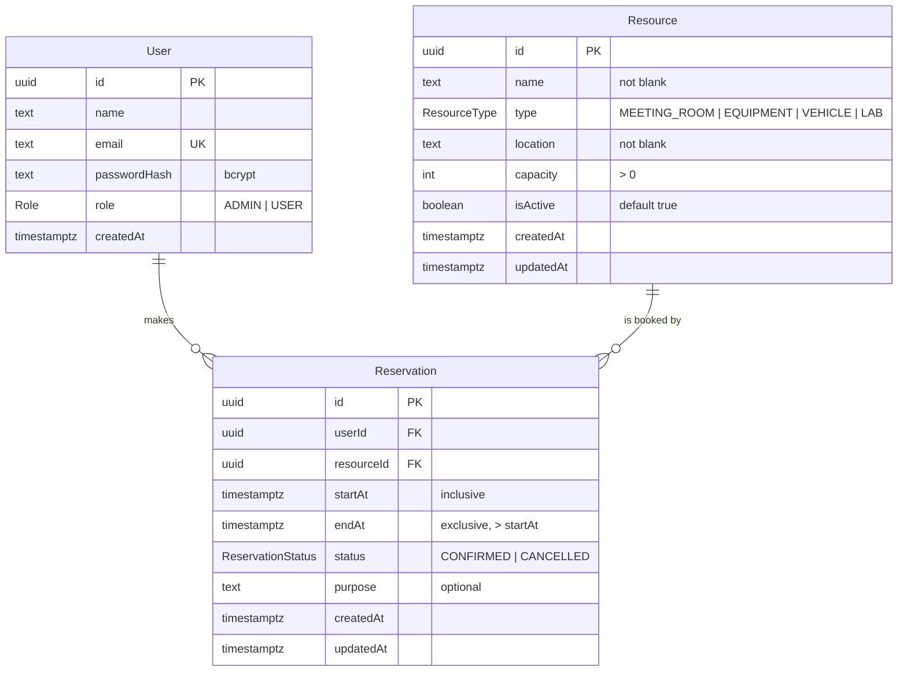

# Entity-relationship diagram

**Shareable diagram (dbdiagram.io):** <https://dbdiagram.io/d/RRMS_assingment-6ad096c5064322c8695a7dc7> (made from the DBML below).

The source of truth is [`prisma/schema.prisma`](../prisma/schema.prisma) plus the hand-written constraints at the end of [`prisma/migrations/20261014084547_init_reservation_schema/migration.sql`](../prisma/migrations/20261014084547_init_reservation_schema/migration.sql).

## Diagram



## Relationships

| Relationship | Cardinality | On delete |
| --- | --- | --- |
| User → Reservation | one user has zero or many reservations | `RESTRICT`: a user with bookings cannot be deleted |
| Resource → Reservation | one resource has zero or many reservations | `RESTRICT`: resources with bookings are deactivated (`isActive = false`), not deleted |

## Constraints and indexes

| Name | Table | Definition | Purpose |
| --- | --- | --- | --- |
| `reservation_no_confirmed_overlap` | Reservation | `EXCLUDE USING gist ("resourceId" WITH =, tstzrange("startAt", "endAt", '[)') WITH &&) WHERE (status = 'CONFIRMED')` | No two confirmed bookings of the same resource overlap. Enforced atomically, including for concurrent requests. Cancelled rows are ignored, so cancelling frees the slot. `'[)'` lets one booking start exactly when another ends. Needs the `btree_gist` extension for `uuid` equality inside a GiST index. |
| `reservation_valid_time` | Reservation | `CHECK ("endAt" > "startAt")` | Rejects zero-length and reversed intervals. |
| `resource_capacity_positive` | Resource | `CHECK (capacity > 0)` | Capacity is a positive integer. |
| `resource_name_not_blank`, `resource_location_not_blank` | Resource | `CHECK (btrim(...) <> '')` | No blank names or locations. |
| `User_email_key` | User | unique index on `email` | One account per email. |
| `Reservation_userId_startAt_idx` | Reservation | index on `(userId, startAt)` | "My bookings" listings, sorted by time. |
| `Reservation_resourceId_startAt_idx` | Reservation | index on `(resourceId, startAt)` | A resource's schedule. |

## DBML for dbdiagram.io

DBML cannot express exclusion constraints, so the constraint is recorded as a table note.

```dbml
Project rrms {
  database_type: 'PostgreSQL'
  Note: 'Resource Reservation Management System. Overlap rule enforced by a PostgreSQL EXCLUDE USING gist constraint; see Reservation note.'
}

Enum Role {
  ADMIN
  USER
}

Enum ResourceType {
  MEETING_ROOM
  EQUIPMENT
  VEHICLE
  LAB
}

Enum ReservationStatus {
  CONFIRMED
  CANCELLED
}

Table User {
  id uuid [pk]
  name text [not null]
  email text [not null, unique]
  passwordHash text [not null, note: 'bcrypt hash']
  role Role [not null, default: 'USER']
  createdAt timestamptz [not null, default: `now()`]
}

Table Resource {
  id uuid [pk]
  name text [not null, note: 'CHECK not blank']
  type ResourceType [not null]
  location text [not null, note: 'CHECK not blank']
  capacity int [not null, note: 'CHECK capacity > 0']
  isActive boolean [not null, default: true]
  createdAt timestamptz [not null, default: `now()`]
  updatedAt timestamptz [not null]
}

Table Reservation {
  id uuid [pk]
  userId uuid [not null, ref: > User.id]
  resourceId uuid [not null, ref: > Resource.id]
  startAt timestamptz [not null, note: 'inclusive']
  endAt timestamptz [not null, note: 'exclusive; CHECK endAt > startAt']
  status ReservationStatus [not null, default: 'CONFIRMED']
  purpose text
  createdAt timestamptz [not null, default: `now()`]
  updatedAt timestamptz [not null]

  indexes {
    (userId, startAt)
    (resourceId, startAt)
  }

  Note: '''
  reservation_no_confirmed_overlap:
  EXCLUDE USING gist ("resourceId" WITH =, tstzrange("startAt", "endAt", '[)') WITH &&)
  WHERE (status = 'CONFIRMED')
  Requires the btree_gist extension. Foreign keys are ON DELETE RESTRICT.
  '''
}
```
